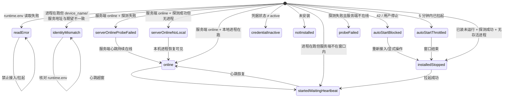

# 本机 Worker 展示修复 + 接管结束停会话（dev-ch-11）

> 分支：`feat/local-worker-time-takeover`（基线 `origin/dev-ch-11 @ 815c268`）
> 涉及文件：`src/local-runtime.ts`、`src/index.ts`、`src/time-format.ts`、`src/render/tables.ts`、
> `src/focus.ts`、`src/client/session-ctl.ts`、`src/client/index.tsx`、
> `src/client/GrapeMachinePanel.tsx`、`src/client/GrapeFocusPanel.tsx`、
> `src/client/GrapeBrowsePanel.tsx`、`test/*`

## 一、需求

1. **本机 worker 展示**
   1. 解析 worker 设备失败（面板「设备信息读取失败」/「未检测到 grape CLI」/设备名为空）
   2. 时间显示成 UTC（服务端存 UTC，面板/工具输出没换算成本地时间）
2. **接管之后没有自动停止会话的能力**：面板点「确认完成」/「放弃接管」后，本地 DSH 会话仍在跑，
   会与下一节点双写同一 worktree。
3. **官网深链跳错页面**：面板「在官网打开 / 在侧栏浏览器打开」拼出的地址前端不认。

## 二、需求 1：本机 worker 展示

### 2.1 设备解析失败（根因 → 修法）

**根因（可复现）**：插件把「能找到 grape CLI」等同于「PATH 里有 `grape`」。
Windows 侧 `/install-grape` 只能把 CLI 装进 venv（`%LOCALAPPDATA%\grape-cli\.venv\Scripts\grape.exe`，
安装器没有软链），宿主重启后 `installedGrapeBin` 这个**进程内变量**也丢了 → 明明装着 CLI，
`/check` 却报「未检测到 grape CLI」，凭据列表读不出来，面板表现就是「设备解析失败」。
另有两条同类机器事实容易被漏：worker 安装脚本自己也会留一份
`%USERPROFILE%\grape\.venv\Scripts\grape.exe`（实测 `grape 0.3.4` 可用）；Windows 的 `.cmd`/`.bat`
包装器**不能**直接 `spawn`（EINVAL），必须走 `cmd.exe /c`。

**修法**（`src/local-runtime.ts` 新增 `resolveGrapeBin()` 等）：

| 层 | 来源 | 行为 |
|---|---|---|
| ① | 插件 config `bin` | 显式配置最优先，探不通也照用（报错要指出用户配的路径） |
| ② | `GRAPE_CLI_BIN` | 同上 |
| ③ | 本次会话内刚装好的路径 | 需 `--version` 探通，避免陈旧指针挡住后面的候选 |
| ④ | 已知安装目录 | 插件安装器 `installLayout().grapeBin` + worker 安装脚本的 venv（win/posix 各一套），Windows 上没有软链 |
| ⑤ | PATH 上的平台可执行名 | 真的能跑 `--version` 才算数；系统 Python 里 pip 全局装的那份可能很旧，所以排最后 |
| - | 都没有 | `source: 'missing'`，回传 `tried` 清单供排障 |

- `commandWrapper()`：Windows 的 `.cmd`/`.bat` → `cmd.exe /c <bin>` 前缀；其余原样（`shell: false` 不变，
  参数仍是数组，不引入 POSIX 重定向那类问题）。
- `/check` 新增返回 `bin` / `binSource` / `binTried`，`probeError` 里带上来源与已尝试路径。
- 面板（`GrapeMachinePanel`）在 CLI 不可用时把 `probeError + 探测路径（来源）` 显示出来，
  不再只说「未检测到」。
- 已安装但 `runtime.env` 里没有 `RUNTIME_DEVICE_NAME` 时，设备卡明确提示「没读到设备名」，
  **不会**自动把设备名改成主机名（设备名是身份，改了就换 `runtime_id`）。
- `parseEnvText()` 容错：UTF-8 BOM、`export `/`set `/`$env:` 前缀、单双引号、行尾注释、值里带 `=`。

### 2.2 时间显示成 UTC

- `src/time-format.ts` 新增 `parseServerTime()`：**没有 `Z` 也没有 `±HH:MM` 的串按 UTC 解析**，
  `formatTime()` 复用同一口径（原来 `formatTime` 自己实现，`relTime` 用的是裸 `Date.parse`）。
- `src/client/GrapeBrowsePanel.tsx` 的 `relTime()`（事件/最新事件相对时间）改用 `parseServerTime`：
  过去无时区串被当本地时间，「8 小时前」会显示成「刚刚」。
- `src/render/tables.ts` 的 Issue 详情 `创建: …` 改用 `formatTime()`，不再原样透出 UTC。

## 三、需求 2：接管结束停会话

### 3.1 为什么放在客户端

会话对象只存在于**前端** `ctx.sessions`（dsh-api-session-controller 的 client 侧）：
`service.using(id, { source }, ref => …)` 拿到的 `ref.binding.session` 上才有 `cancel()`
（停当前这一轮，会话留在列表里可回看）。插件本来就在用这套 API 建会话 + 发首条 prompt
（`src/client/index.tsx` 的 `setApiSessionCreator`），复用同一条链路即可，
**不需要**宿主侧 `ctx.inject(['sessions'])` —— 早期版本走宿主注入，把 dsh 自己的会话能力一起带坏了，
已整体回滚（宿主只保留 attach/finish/abort 路由的原有行为）。

### 3.2 `src/client/session-ctl.ts`（新，纯逻辑 + 注入）

- `setApiSessionStopper(fn)`：`apply()` 时注入真实实现（拿得到 client ctx 的 `sessions`）。
- `stopLocalSession(sessionId)`：
  - 空 id → 「没有记录本地会话 id，未停止会话（可在会话列表里手动停）」
  - 没注入 → 「当前 DSH 前端不支持停止会话，请手动停止（不影响流水线推进）」
  - `cancel()` 返回 `ok: false` → 抛出并转成一句话提示
  - **永不抛给调用方**：停止只是收尾动作，不能把「已确认完成 / 已放弃」变成报错
- 语义是「暂停」而非删除：`cancel()` 打断当前这一轮，上下文仍可回看。

### 3.3 面板侧（`GrapeFocusPanel`）

- 「确认完成 · 派发下一节点」与「放弃接管」都**先 `window.confirm`**，确认文案写清两个后果
  （平台会推进 / 本地会话会被停）。
- 顺序固定为 **先平台、后本地**：`takeover-finish` / `takeover-abort` 成功 → `stopLocalSession(sess.local)`
  → 把 `stop.message` 并进提示条。反了会先停掉 agent，交接内容就没了。
- 停之前先读 `getSnapshot().running`：这一轮已经结束就回「已空闲，无需停止」（`ok:true`），
  避免 `cancel()` 对空闲会话返回 `ok:false` 时被误报成「停止会话失败」。
- 停止成功后（finish 路径）再调 `takeover-release` 回收工作区里的 `.grape-takeover-token`；
  停止失败则**保留** token（agent 可能还在跑），只是提示手动停。
- 停止失败只影响提示文案，平台的完成/放弃结果照常展示。
- 请求体**不再**带 `session_id`（宿主侧已回滚，传了也没人读）。

### 3.4 已回滚的旧实现（别再照它改）

早期版本在宿主侧做了 `src/takeover-session-stop.ts`（`stopTakeoverSession` 状态机、
`planFinishGate`、`verifyTakeoverSessionOwner`、`planSessionScan`）并：
`ctx.inject(['sessions'])` 拿 `hostSessions`、attach 时登记 `takeoverClientSessions`、
finish/abort 里先停会话再调平台、`/check` 回传 `sessionsApi`。
这套东西已整体删除（连带 `test/takeover-session-stop.test.mjs`、`test/takeover-finish-gate.test.mjs`、
`test/takeover-artifacts.test.mjs`），`collectFinishArtifacts()` 也回到不带 `sessionId` 的签名。
原因：用户反馈接管之前的正常能力被改坏（「打开本地会话」按钮消失、dsh 自己新建会话失效），
且宿主注入与 dsh 自身会话服务冲突，收益（自动停）在客户端同样能拿到。

### 3.5 接管工作区跑不起来（根因：平台的远端 cwd 直接当本机路径）

2026-11-18 12:42 复现日志（`%TEMP%\grape-dsh-takeover.log`）拿到决定性证据：

```
POST /grape-worker-api/takeover → 200 ok:true
  workspaceId:       ""
  workspaceCwd:      /root/grape-workspaces/gitcode/developer_ch/takeover-ch/issues/1/vod
  workspaceError:    Workspace path is not fully qualified:
                     '/root/grape-workspaces/gitcode/developer_ch/takeover-ch/issues/1/vod'
  workspaceCreated:  false
client panel_response → workspaceId "" → 后续没有任何 switch_start / session_created_via_api
```

即：平台 `bundle.workspace.cwd_hint` 给的是**远端 Linux worker** 上的目录，
桌面端在 Windows 上把它直接交给 dsh 的 `workspaceRegistry.create`，
dsh 判「不是完全限定路径」（Windows 需要盘符）→ workspace 建不出来 →
`workspaceId` 为空 → 前端不起会话 → 「打开本地会话」按钮没有、点接管看起来「卡住」。
附带副作用：`mkdirSync('/root/...')` 在 Windows 上落到了盘符根的 `C:\root\grape-workspaces\...`。

修法（`src/takeover-workspace.ts`，纯函数 + 注入，Linux CI 也能测 Windows 分支）：

| 情形 | 结果 | `source` |
|---|---|---|
| 远端路径在本机**完全限定且存在**（同一台机器接管本地任务） | 原样复用，能带上已有代码 | `local` |
| 其他情况 | 取 `grape-workspaces/` 之后的尾部，拼到本机工作区根 | `mapped` |
| 平台给了 cwd 但不含 `grape-workspaces` 标记 | `<owner>/<repo>/issues/<n>/<agent>` 兜底生成 | `derived` |

> 注意：`/takeover` 在平台**完全没给 cwd** 时直接返回 500（这条守卫在本轮之前就有），
> 所以 `derived` 实际只在「有 cwd 但结构不认识」时才会走到。

- 本地工作区根：`GRAPE_TAKEOVER_WORKSPACE_ROOT` / `GRAPE_WORKSPACE_ROOT`（必须是完全限定路径）
  → 否则 `<用户主目录>/grape-workspaces`。**源码里没有任何具体机器的目录名或产品名**。
- 尾部层数不写死（`gitcode/<owner>/<repo>/issues/...` 这种多一层也照用），
  段级清洗去掉 Windows 非法字符与结尾点/空格，并中和 `..`（不会逃出本地根）。
- `isTakeoverWorkspacePath()` 的清理匹配同步放宽到「任意层前缀 + 尾部结构」——
  原正则要求 `grape-workspaces/<a>/<b>/issues/…` 两段，真实的 `gitcode/<owner>/<repo>` 三段永远不命中，
  侧栏淘汰一直没生效。
- 面板：没建出 workspace 时把 `workspaceError` 原话带进提示，不再只是「接管了却没反应」。
- `/takeover` 回复新增 `workspaceCwdSource`（local/mapped/derived）、`remoteCwd`、`workspaceNotice`。
- **finish / abort 的回退路径同样要本地化**：宿主重启后内存表 `takeoverCwds` 丢了，
  从平台快照的 `cwd_hint` 找回的是远端路径，直接当本机路径用会导致
  finish 采不到交接内容、abort 删错 token 文件（Windows 上 `/root/x` 会解析成当前盘）。
  现统一走 `resolveTakeoverCwdLocal()`（内部复用 `localizeTakeoverCwd`）；拿不到
  `grape-workspaces` 尾部时不猜（`derived` 需要 repo/issue/agent，这条路径没有）。
- **token 文件回收**：finish 不能直接删 token（agent 可能还在收尾），新增
  `POST /grape-worker-api/takeover-release`：客户端确认「本地会话已停 / 已空闲」后调用，
  宿主删掉 `.grape-takeover-token` 并清本地映射；abort 成功仍在宿主侧直接删。

排障方法论：桌面端宿主的 `console.log` 不落盘、renderer console 也抓不到。
本轮临时用过写文件的诊断（`_diag()` → `%TEMP%\grape-dsh-takeover.log`），
定位完成后**已按计划移除**：它会把接管 prompt 全文与路径无脱敏写进共享临时目录的固定文件名，
不合适留在发布版本里。以后需要时可以按 `GRAPE_DSH_DIAG=1` 门控 + 私有目录 + 字段白名单重做。

## 四、需求 3：官网深链

线上前端契约（2026-11-18 实测 `static/js/deeplink.js` + `static/js/app.js`）：

- 路径：`/app/<owner>/<repo>/`（也认 `/en/app/...`），前端据此应用仓库
- 哈希：`#<view>[/<param>]`，`pipe` 的 param 是 issue 号；`event` / `observability` 属无仓库视图

| 视图 | 旧（错） | 新 |
|---|---|---|
| 流水线 | `/app/#pipe/8?repo=alice/proj` | `/app/alice/proj/#pipe/8` |
| 事件 | `/app/#event/123?repo=alice/proj` | `/app/alice/proj/#event/123` |
| 概览 | `/app/#dash?repo=alice/proj` | `/app/alice/proj/#dash` |
| 运维 | `/app/#observability` | `/app/#observability` |

- 前端根本不读 `?repo=` → 旧链接会静默落到「当前仓库」或仓库列表页，同号不同仓库直接串。
- `grapeAppUrl()` 同步做 baseUrl 归一（去尾斜杠、去结尾 `/app`），owner/repo 走 `encodeURIComponent`。
- 仓库维度既然已进路径，面板里「若官网未自动切到 X，请手动选择仓库」的兜底提示一并删除。

## 五、需求 4：接管期间禁止自动派发（插件侧守门）

平台侧的规则（服务端单独立项）是「该 issue 有 active 接管时，webhook / A2A 不再派发」。
插件侧只做两件它**能**做的事，不假装能拦 webhook：

1. **重派前先拦一次**：`/grape-worker-api/event-redispatch` 先 `GET /api/events/{seq}` 拿
   `repo_key` / `issue_id`，再 `GET /api/takeover/sessions?status=active&repo_key=..&issue_id=..`；
   命中就回 `409 takeover_active` + 一句中文原因（谁在接管哪个节点、takeover id、该点哪里）。
   探测失败一律放行 —— 这是排障入口，平台才是最终拍板的人。
   - 纯逻辑在 `src/takeover-dispatch.ts`（`evaluateRedispatchGuard` / `mapRedispatchReply`），
     面板只认 `detail.message`，所以服务端回 `already_taken_over` 也翻成同一句话。
2. **卡片上说清「为什么没反应」**：接管进行中时，卡片明写「接管期间该 issue 暂停自动派发，
   其他节点的『重新派发』也会被拒绝，推进请用确认完成/放弃接管」。
   用户接管时改标签、发评论触发的 webhook 不会被平台派发，不写这句就会以为平台卡死了。

**不做**：接管期间停掉本机 worker。本机 worker 是按引擎抢单的、**跨 issue 全局**的，
停它会误伤同一台机器上其他 issue 的节点；"别的节点不被拉起" 必须由平台按 issue 守门解决。

## 六、自检

```bash
npm run typecheck                 # 0
npm run build                     # lib/ + lib/client.js
npm test                          # 176 tests / 175 pass / 1 skip / 0 fail
```

覆盖新增用例：

- `test/takeover-workspace.test.mjs`：win32 远端 Linux 路径 → 带盘符映射（且盘符缺失路径即使
  存在也不算本机）、posix 本地任务原样复用、无 cwd 走 derived、尾部层数不写死、
  非法字符/`..` 清洗、根带尾斜杠不拼双分隔符、根缺失返回空、`resolveTakeoverRoot` 优先级、
  `isFullyQualifiedPath` 按平台判断；`localizeRestoredCwd`（宿主重启恢复）不猜 derived。

- `test/local-runtime.test.mjs`：`commandWrapper`（.cmd/.bat → cmd.exe /c）、`grapeBinCandidates`、
  `resolveGrapeBin` 五层回退、`parseEnvText` 容错（BOM/引号/注释/`=`）、
  `removeTakeoverToken`（只删 `.grape-takeover-token`，不存在也算成功、空目录跳过）。
- `test/time-format.test.mjs`：`parseServerTime` 的 UTC 口径、`formatTime` 换算与降级。
- `test/focus.test.mjs`：深链路径式（含用户给的 beta 实例）、无仓库回退、baseUrl 归一、
  URL 编码、同号不同仓库互不相同。
- `test/takeover-fallback.test.mjs`：legacy 兜底回复（attach/finish/abort 的 404/405 回退）。
- `test/takeover-dispatch.test.mjs`：重派守门（无事件放行、无接管放行、有接管 409 且原因含节点/接管人/id、
  多条接管计数、缺字段不出空占位）、`mapRedispatchReply`（成功透传 / `already_taken_over` 翻中文 /
  其它错误不改写）。

## 七、已知限制 / 不在本单范围

- 老宿主没有 `sessions.using` / `binding.session.cancel` → 只提示手动停止，不阻断完成/放弃。
- 接管到本机的只是**空目录 + env/技能/图谱**：远端 worker 上的代码与产物不会迁移过来，
  仍由 agent 用 `grape git clone` 自建（原设计如此，映射路径只是给它一个合法 cwd）。
- 旧版本把远端 `/root/...` 当本机路径写过 `<盘符>:\root\grape-workspaces\...`（见 §3.5），
  升级后可安全删除该遗留目录（里面只有插件生成的 env/技能文件，没有代码）。
- 停止是「暂停当前轮」，不删除会话、不清上下文；要做「结束后自动归档」需要平台侧配合。
- 服务端 `takeover` 是否把 `client_session` 回传、`abort` 是否重派，仍由平台决定。
- 服务端不支持「finish 时自动 A2A 派发」时回 405：面板提示「请到平台手动推进下一节点」，
  不再表述成「派发失败」（节点其实已经走完）。
- 宿主侧不做「读 `running` 决定按钮文案」那类门禁，避免把一次修复扩成 UI 重构。

## 八、本机 Worker 状态机与故障排查树（Issue #25）

> 背景：面板曾只看 `processAlive` 布尔值 —— PowerShell 探测超时/不可用被当成「没有进程」，
> 于是显示「未运行」并自动再拉起一份 worker，造成同设备凭据争用与心跳抖动。
> 现在改为「本地事实 + 服务端心跳 + 探测元数据 + 凭据状态 + 拉起护栏」合成 12 态，
> 服务端 `last_seen_at` 落在 2×`RUNTIME_HEARTBEAT_INTERVAL` 内时以服务端为准。

### 8.1 状态机



| 状态 | 含义 | 建议 | 允许自动拉起 |
|---|---|---|---|
| `online` | 本机进程与服务端心跳一致 | 无需操作 | 否 |
| `not-installed` | 未检测到安装 | 点击「接入本机」 | 否 |
| `installed-stopped` | 已装未运行 | 自动/手动拉起（5 分钟 1 次） | **是** |
| `started-waiting-heartbeat` | 进程在跑，服务端未见心跳 | 等一个心跳周期；查网络/服务地址 | 否 |
| `server-online-probe-failed` | **探测不可用 / 服务端在线** | 修探测工具，切勿重复拉起 | 否 |
| `server-online-no-local-process` | 服务端在线，本机未枚举到进程 | 以服务端为准，不拉起 | 否 |
| `identity-mismatch` | device_name / 服务地址与服务端不一致 | 核对 runtime.env | 否 |
| `credential-inactive` | 凭据不是 active | 重新接入（吊销并重建） | 否 |
| `autostart-throttled` | 5 分钟节流内 | 稍后刷新，不要重复触发 | 否 |
| `autostart-blocked` | 42 / 用户停止 | 重新接入或显式操作 | 否 |
| `probe-failed` | 探测失败且服务端不在线 | 修探测工具后再判断 | 否 |
| `read-error` | 配置读取失败（权限/IO） | 修权限，不要重复接入 | 否 |

### 8.2 故障排查树（症状 → 判定依据 → 动作）

```
面板说「未运行」但服务端设备 health=online
├─ 判定依据：服务端 last_seen_at 在 2×heartbeat 内？
│  ├─ 是 → 状态应为「探测不可用 / 服务端在线」或「服务端在线，本机未探测到进程」
│  │       动作：看「判定依据」里的探测 method/error/stderr；修 PowerShell/ps 探测；不要拉起
│  └─ 否（心跳超窗）→ 看本机进程是否真的在跑
│     ├─ 在跑 → started-waiting-heartbeat：查网络、RUNTIME_SERVER_URL、凭据状态
│     └─ 没跑 → installed-stopped：允许一次拉起（5 分钟节流）
│
面板说「探测失败」
├─ 判定依据：probe.ok=false（超时/ENOENT/权限），stderr 前 20 行
└─ 动作：修复探测命令/权限；此状态永远不会自动拉起

面板出现两个 agent 进程
├─ 判定依据：probe.matched 中多个 pid（venv + 非 venv 解释器）
└─ 动作：护栏已拒绝再次拉起；手动停掉多余进程（保留 runtime.env 对应的那份）

面板说「身份不一致」
├─ 判定依据：basis 中 device_name / 服务地址对比
└─ 动作：核对本机 runtime.env 的 RUNTIME_DEVICE_NAME / RUNTIME_SERVER_URL

面板说「凭据非 active」
├─ 判定依据：服务端 credential_status
└─ 动作：重新接入（会签发新凭据；旧身份需在服务端设备中心清理）

复制诊断信息
└─ 已脱敏：RUNTIME_TOKEN、tk_ / grape_ / tko_ / rta_ / Bearer / api_key 等键值全部替换为 [已脱敏]
```

### 8.3 实现位置（便于排障）

- 纯函数：`src/local-runtime.ts` 的 `readLocalWorker` / `classifyWorkerState` /
  `evaluateStartGuard` / `shouldAutoStartWorker` / `buildWorkerStartRecord`。
- 路由：`src/index.ts` 的 `GET /grape-worker-api/check`、`POST /ensure-worker`、
  `POST /onboard`（`action=start`）。
- 面板：`src/client/GrapeMachinePanel.tsx`（状态 + 建议 + 折叠判定依据 + 复制诊断）。
- 单测：`test/local-runtime.test.mjs`（探测失败、双进程、凭据非 active、服务端在线本地探测失败、
  节流、拉起失败回写、身份不一致、脱敏、12 态齐全）。
